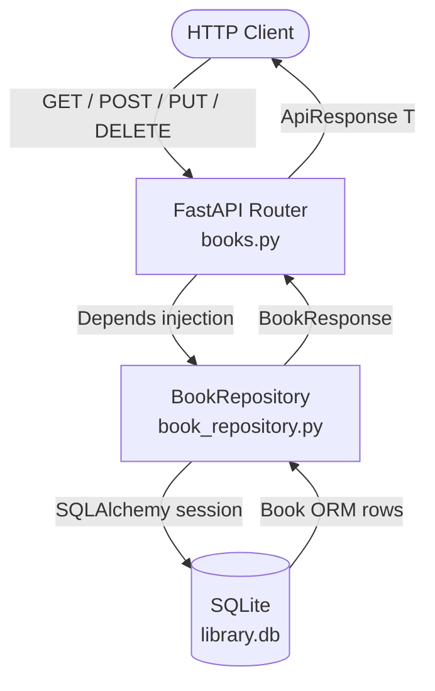
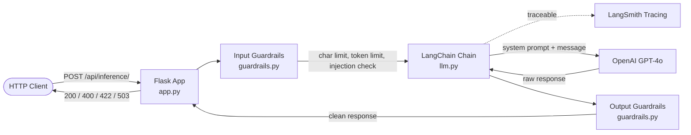
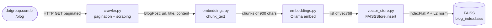
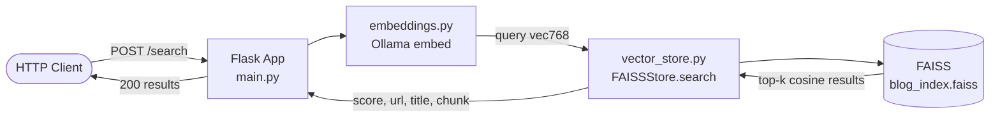

# Backend IA — Projects

Three independent Python backend projects covering REST APIs, LLMs, and semantic search.

---

## Projects

| # | Project | Main Stack |
|---|---------|------------|
| 1 | [Library FastAPI](#1-library-fastapi) | FastAPI · SQLite · SQLAlchemy · pytest |
| 2 | [Chatbot Python](#2-chatbot-python) | Flask · LangChain · GPT-4o · LangSmith |
| 3 | [Semantic Search Blog](#3-semantic-search-blog) | Flask · FAISS · Ollama · BeautifulSoup4 |

---

## 1. Library FastAPI

REST API for managing a virtual library. Supports creating, listing, updating, and soft-deleting books, with pagination, filters, and a generic `ApiResponse[T]` response envelope applied to every route.

### Technologies

| Layer | Technology |
|-------|-----------|
| Framework | FastAPI + Uvicorn |
| Database | SQLite via SQLAlchemy 2.x (`Mapped` / `mapped_column`) |
| Validation | Pydantic v2 |
| Data access | Repository pattern (`BookRepository`) |
| Tests | pytest + httpx — 88 cases (unit + integration) |

### Endpoints

| Method | Route | Description |
|--------|-------|-------------|
| `GET` | `/` | Health check |
| `POST` | `/books/` | Create a book |
| `GET` | `/books/` | List books with filters and pagination |
| `PUT` | `/books/{id}` | Partial update |
| `DELETE` | `/books/{id}` | Soft delete (`is_active = False`) |
| `GET` | `/books/{id}` | Get book by ID |

### Flow



---

## 2. Chatbot Python

Stateless REST API specialized in Python-related answers. Built with Flask and LangChain, with LangSmith tracing on every inference call. Each request is independent — no conversation history is kept between calls. Input and output guardrails protect against prompt injection and sensitive data leakage.

### Technologies

| Layer | Technology |
|-------|-----------|
| Framework | Flask 3.x |
| LLM | OpenAI GPT-4o via LangChain (`temperature=0.3`, `max_tokens=800`) |
| Tracing | LangSmith (`@traceable` decorator) |
| Token counting | tiktoken `cl100k_base` |
| Guardrails | 16 input injection patterns + 6 output sensitive-data patterns |
| Config | python-dotenv |

### Guardrails

| Direction | Checks |
|-----------|--------|
| Input | Max 2000 chars, max 500 tokens, 16 prompt-injection regex patterns |
| Output | API keys (`sk-`, `AKIA`), Bearer tokens, credit card, SSN, system prompt leakage |

### Flow



---

## 3. Semantic Search Blog

Semantic search system that crawls articles from the [dotgroup.com.br](https://dotgroup.com.br/blog) blog, generates embeddings locally with Ollama, and indexes them in a FAISS vector store using cosine similarity. Exposes a Flask REST API for similarity-based queries.

### Technologies

| Layer | Technology |
|-------|-----------|
| Framework | Flask |
| Web crawling | requests + BeautifulSoup4 + lxml |
| Embeddings | Ollama `nomic-embed-text` (dim 768, runs locally) |
| Vector store | FAISS `IndexFlatIP` + L2 normalization (cosine similarity) |
| Persistence | `blog_index.faiss` + `blog_meta.json` |
| Chunking | Sliding window — 900 chars, 120 chars overlap |

### Endpoints

| Method | Route | Description |
|--------|-------|-------------|
| `POST` | `/search` | Semantic search over indexed chunks |
| `GET` | `/stats` | Returns total number of indexed chunks |

### Indexing Flow



### Search Flow



---

## Getting Started

Each project has its own `requirements.txt` and `specs.md` with detailed setup instructions.

```
backend_ia/
├── library_fastapi/       # Virtual library REST API
├── chatbot_python/        # Stateless Python chatbot with guardrails
└── semantic_search_blog/  # Semantic search over Dots Digital Group blog
```
